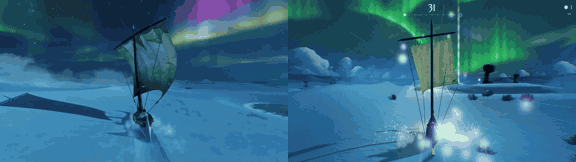

# Aurora Skiff

**Play it:** [fal-video-to-game.vercel.app/B08_AURORA-SKIFF/](https://fal-video-to-game.vercel.app/B08_AURORA-SKIFF/)

**Video prompt** (MiniMax H3 Max, `minimax/h3-max/text-to-video`):

> A nomad steers a small sand skiff with a cloth sail across glowing blue dunes at night, catching the wind under a sky full of green and violet auroras.

**Controls:** ← → / A D / stick or D-pad steer · Space / A gust · Enter / Start start · Esc / P / Start pause · M sound

**Assets generated on fal:** 10 images, 6 3D models, 15 sounds and music,
23 calls, 2.79 USD.

| Endpoint | Calls |
|---|---|
| `fal-ai/stable-audio-3/small/sfx/text-to-audio` | 14 |
| `fal-ai/hyper3d/rodin/v2.5` | 6 |
| `fal-ai/birefnet/v2` | 2 |
| `google/lyria-3.5` | 1 |

**Code:** [`game/`](game/), written by Claude Opus 5.5 with Three.js only. The assets are not in this repository
(the full game is about 10 to 100 MB); play it at the link above.
