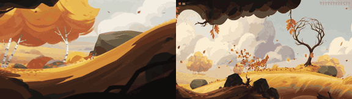

# Autumn Wind

**Play it:** [fal-video-to-game.vercel.app/A10_AUTUMN-WIND/](https://fal-video-to-game.vercel.app/A10_AUTUMN-WIND/)

**Video prompt** (MiniMax H3 Max, `minimax/h3-max/text-to-video`):

> A child in a cloak of orange leaves surfs the wind over golden hills with a swirling swarm of leaves, painted in bold brush strokes.

**Controls:** Space / ↑ / click jump · hold in the air to glide on your leaf swarm · ↓ / Shift dive · M sound

**Assets generated on fal:** 37 images, 2 3D models, 9 sounds and music,
47 calls, 10.20 USD.

| Endpoint | Calls |
|---|---|
| `fal-ai/nano-banana-pro/edit` | 25 |
| `fal-ai/birefnet/v2` | 12 |
| `meshy/v7.1/image-to-3d` | 3 |
| `fal-ai/nano-banana-pro` | 3 |
| `fal-ai/elevenlabs/sound-effects/v2` | 2 |
| `fal-ai/meshy/rigging/multi-animation` | 1 |
| `elevenlabs/music/v2.5` | 1 |

**Code:** [`game/`](game/), written by Claude Opus 5.5 with Three.js only. The assets are not in this repository
(the full game is about 10 to 100 MB); play it at the link above.
