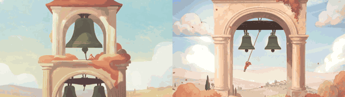

# Bell Tower

**Play it:** [fal-video-to-game.vercel.app/A14_BELL-TOWER/](https://fal-video-to-game.vercel.app/A14_BELL-TOWER/)

**Video prompt** (MiniMax H3 Max, `minimax/h3-max/text-to-video`):

> A bell-ringer swings on long ropes inside a giant pastel bell tower; each bell she rings sends a wave of color rolling across the sky outside the arches.

**Controls:** ← → swing the bell-ringer (pump in rhythm to hit the bells) · ↑ ↓ climb the rope · reach the golden rope to go up a floor · any key starts

**Assets generated on fal:** 17 images, 2 3D models, 6 sounds and music,
29 calls, 7.27 USD.

| Endpoint | Calls |
|---|---|
| `fal-ai/nano-banana-pro/edit` | 18 |
| `fal-ai/elevenlabs/sound-effects/v2` | 5 |
| `fal-ai/nano-banana-pro` | 2 |
| `meshy/v7.1/image-to-3d` | 1 |
| `fal-ai/meshy/rigging/multi-animation` | 1 |
| `fal-ai/hunyuan-3d/v3.1/pro/image-to-3d` | 1 |
| `elevenlabs/music/v2.5` | 1 |

**Code:** [`game/`](game/), written by Claude Opus 5.5 with Three.js only. The assets are not in this repository
(the full game is about 10 to 100 MB); play it at the link above.
