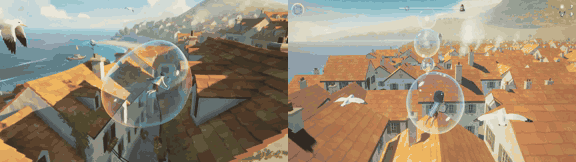

# Bubble Balloon

**Play it:** [fal-video-to-game.vercel.app/B10_BUBBLE-BALLOON/](https://fal-video-to-game.vercel.app/B10_BUBBLE-BALLOON/)

**Video prompt** (MiniMax H3 Max, `minimax/h3-max/text-to-video`):

> A child floats inside a giant soap bubble over a sunny seaside village, steering it by leaning, bouncing gently off rooftops and chimneys while seagulls follow.

**Controls:** ← → steer · ↑ dive / ↓ slow · Space / A puff · Enter / Start play · Esc / Start pause · M sound

**Assets generated on fal:** 14 images, 5 3D models, 9 sounds and music,
18 calls, 2.18 USD.

| Endpoint | Calls |
|---|---|
| `sonilo/v1.1/text-to-sound-effects` | 8 |
| `fal-ai/hyper3d/rodin/v2.5` | 5 |
| `fal-ai/birefnet/v2` | 4 |
| `google/lyria-3.5` | 1 |

**Code:** [`game/`](game/), written by Claude Opus 5.5 with Three.js only. The assets are not in this repository
(the full game is about 10 to 100 MB); play it at the link above.
