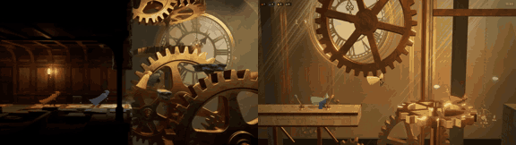

# Clockwork Heist

**Play it:** [fal-video-to-game.vercel.app/H02_CLOCKWORK-HEIST_4p/](https://fal-video-to-game.vercel.app/H02_CLOCKWORK-HEIST_4p/)

**Video prompt** (MiniMax H3 Max, `minimax/h3-max/text-to-video`):

> Four-player co-op heist game inside a colossal clock tower: four small thieves in red, blue, yellow and green cloaks time their jumps across giant rotating brass gears and swinging pendulums, one holds a lever so the others can pass, polished brass, oiled wood and dusty light beams. Wide side-on 3D camera showing all four players.

**Controls:** P1: A/D move, W jump, S hold lever · P2: arrows, ↑ jump, ↓ lever · P3: J/L, I jump, K lever · P4: numpad 4/6, 8 jump, 5 lever · gamepads supported

**Assets generated on fal:** 18 images, 5 3D models, 16 sounds and music,
28 calls, 9.03 USD.

| Endpoint | Calls |
|---|---|
| `fal-ai/nano-banana-pro/edit` | 15 |
| `meshy/v7.1/image-to-3d` | 5 |
| `fal-ai/nano-banana-pro` | 3 |
| `fal-ai/bria/background/remove` | 2 |
| `fal-ai/meshy/rigging/multi-animation` | 1 |
| `elevenlabs/music/v2.5` | 1 |
| `fal-ai/elevenlabs/sound-effects/v2` | 1 |

**Code:** [`game/`](game/), written by Claude Opus 5.5 with Three.js only. The assets are not in this repository
(the full game is about 10 to 100 MB); play it at the link above.
