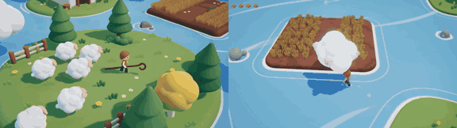

# Cloud Shepherd

**Play it:** [fal-video-to-game.vercel.app/S17_CLOUD-SHEPHERD/](https://fal-video-to-game.vercel.app/S17_CLOUD-SHEPHERD/)

**Video prompt** (MiniMax H3 Max, `minimax/h3-max/text-to-video`):

> Soft pastel 3D game: a shepherd with a long crook herds fluffy little clouds like sheep across a blue sky meadow, pushing them together so they merge into a rain cloud that waters a dry floating field. Third-person camera.

**Controls:** WASD / arrows walk · Shift run · Space swing the crook (pushes the cloud-sheep) · E whistle · Enter start · M sound

**Assets generated on fal:** 10 images, 20 3D models, 11 sounds and music,
51 calls, 4.27 USD.

| Endpoint | Calls |
|---|---|
| `fal-ai/nano-banana-pro/edit` | 20 |
| `tripo3d/h3.1/image-to-3d` | 16 |
| `fal-ai/elevenlabs/sound-effects/v2` | 10 |
| `fal-ai/nano-banana-pro` | 2 |
| `fal-ai/birefnet/v2` | 2 |
| `elevenlabs/music/v2.5` | 1 |

**Code:** [`game/`](game/), written by Claude Opus 5.5 with Three.js only. The assets are not in this repository
(the full game is about 10 to 100 MB); play it at the link above.
