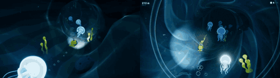

# Deep Lights

**Play it:** [fal-video-to-game.vercel.app/S12_DEEP-LIGHTS/](https://fal-video-to-game.vercel.app/S12_DEEP-LIGHTS/)

**Video prompt** (MiniMax H3 Max, `minimax/h3-max/text-to-video`):

> Bioluminescent deep-sea 3D game, dark navy water, simple glowing shapes: a small yellow submarine touches sleeping jellyfish with its light, each one lights up and becomes a glowing lamp revealing the path deeper into a dark trench. Chase camera behind the submarine.

**Controls:** WASD / arrows steer the submarine · Space / click light pulse (wakes the jellyfish) · Space start · P pause · M sound

**Assets generated on fal:** 10 images, 4 3D models, 4 sounds and music,
17 calls, 4.66 USD.

| Endpoint | Calls |
|---|---|
| `fal-ai/nano-banana-pro/edit` | 6 |
| `meshy/v7.1/image-to-3d` | 4 |
| `fal-ai/nano-banana-pro` | 3 |
| `fal-ai/elevenlabs/sound-effects/v2` | 3 |
| `google/lyria-3.5` | 1 |

**Code:** [`game/`](game/), written by Claude Opus 5.5 with Three.js only. The assets are not in this repository
(the full game is about 10 to 100 MB); play it at the link above.
