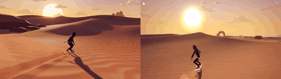

# Dune Surfer

**Play it:** [fal-video-to-game.vercel.app/S11_DUNE-SURFER/](https://fal-video-to-game.vercel.app/S11_DUNE-SURFER/)

**Video prompt** (MiniMax H3 Max, `minimax/h3-max/text-to-video`):

> Low-poly desert 3D game at sunset, flat-shaded orange and purple dunes rolling like ocean waves: a hooded sand surfer on a board rides down the dunes, launches off a crest, spins in the air and lands on the next dune. Chase camera.

**Controls:** Space start · ← → carve · ↓ tuck for speed · hold and release Space to jump · in the air: ← → spin, ↓ backflip, ↑ frontflip, hold Space to grab · M sound

**Assets generated on fal:** 8 images, 6 3D models, 8 sounds and music,
31 calls, 8.10 USD.

| Endpoint | Calls |
|---|---|
| `fal-ai/nano-banana-pro/edit` | 13 |
| `fal-ai/elevenlabs/sound-effects/v2` | 7 |
| `meshy/v7.1/image-to-3d` | 6 |
| `fal-ai/nano-banana-pro` | 2 |
| `fal-ai/bria/background/remove` | 2 |
| `elevenlabs/music/v2.5` | 1 |

**Code:** [`game/`](game/), written by Claude Opus 5.5 with Three.js only. The assets are not in this repository
(the full game is about 10 to 100 MB); play it at the link above.
