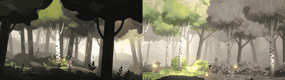

# Ember Path

**Play it:** [fal-video-to-game.vercel.app/A13_EMBER-PATH/](https://fal-video-to-game.vercel.app/A13_EMBER-PATH/)

**Video prompt** (MiniMax H3 Max, `minimax/h3-max/text-to-video`):

> A girl carrying a small glowing ember walks through a charcoal-drawn burnt forest; the ember redraws the trees in vivid green and orange color as she passes.

**Controls:** ← → walk · Shift run · Space / ↑ jump · E blow on the ember (lights a wide circle, burns brambles) · Enter play again

**Assets generated on fal:** 46 images, 16 3D models, 15 sounds and music,
75 calls, 10.03 USD.

| Endpoint | Calls |
|---|---|
| `fal-ai/nano-banana-pro/edit` | 25 |
| `fal-ai/elevenlabs/sound-effects/v2` | 14 |
| `fal-ai/meshy/rigging/multi-animation` | 13 |
| `fal-ai/birefnet/v2` | 12 |
| `meshy/v7.1/image-to-3d` | 8 |
| `fal-ai/nano-banana-pro` | 2 |
| `elevenlabs/music/v2.5` | 1 |

**Code:** [`game/`](game/), written by Claude Opus 5.5 with Three.js only. The assets are not in this repository
(the full game is about 10 to 100 MB); play it at the link above.
