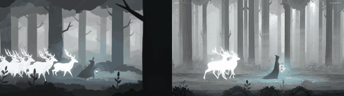

# Fog Shepherd

**Play it:** [fal-video-to-game.vercel.app/A07_FOG-SHEPHERD/](https://fal-video-to-game.vercel.app/A07_FOG-SHEPHERD/)

**Video prompt** (MiniMax H3 Max, `minimax/h3-max/text-to-video`):

> A cloaked figure with a lantern guides a herd of glowing white deer through a monochrome foggy forest; only the circle of lantern light has color.

**Controls:** ← → walk · ↑ ↓ wander into the fog to find the deer · Space / E raise the lantern (calls the herd, scares the spirits) · Enter start · M sound

**Assets generated on fal:** 31 images, 4 3D models, 9 sounds and music,
30 calls, 5.04 USD.

| Endpoint | Calls |
|---|---|
| `fal-ai/nano-banana-pro/edit` | 12 |
| `fal-ai/elevenlabs/sound-effects/v2` | 8 |
| `fal-ai/nano-banana-pro` | 5 |
| `tripo3d/h3.1/image-to-3d` | 4 |
| `elevenlabs/music/v2.5` | 1 |

**Code:** [`game/`](game/), written by Claude Opus 5.5 with Three.js only. The assets are not in this repository
(the full game is about 10 to 100 MB); play it at the link above.
