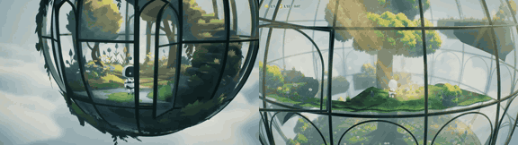

# Glass Greenhouse

**Play it:** [fal-video-to-game.vercel.app/B03_GLASS-GREENHOUSE/](https://fal-video-to-game.vercel.app/B03_GLASS-GREENHOUSE/)

**Video prompt** (MiniMax H3 Max, `minimax/h3-max/text-to-video`):

> A tiny robot gardener tends a greenhouse inside a floating glass sphere above the clouds; it opens glass panes to let beams of sunlight in, and wherever the light falls flowers grow into stairs it climbs.

**Controls:** Arrows / WASD / ZQSD or stick / D-pad move · Space / A open pane, turn crank, jump · Enter / Start start & pause · M sound

**Assets generated on fal:** 13 images, 4 3D models, 17 sounds and music,
26 calls, 2.34 USD.

| Endpoint | Calls |
|---|---|
| `fal-ai/stable-audio-3/small/sfx/text-to-audio` | 16 |
| `fal-ai/hyper3d/rodin/v2.5` | 4 |
| `fal-ai/birefnet/v2` | 4 |
| `fal-ai/trellis-2` | 1 |
| `google/lyria-3.5` | 1 |

**Code:** [`game/`](game/), written by Claude Opus 5.5 with Three.js only. The assets are not in this repository
(the full game is about 10 to 100 MB); play it at the link above.
