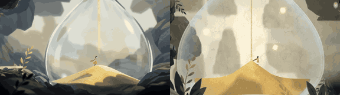

# Hourglass

**Play it:** [fal-video-to-game.vercel.app/A08_HOURGLASS/](https://fal-video-to-game.vercel.app/A08_HOURGLASS/)

**Video prompt** (MiniMax H3 Max, `minimax/h3-max/text-to-video`):

> A tiny wanderer walks inside a giant glass hourglass; golden sand pours from above and piles into dunes that become her path upward toward the neck of the glass.

**Controls:** ← → walk · Space / ↑ jump · hold ↓ / Shift to call the sand into dunes · M sound · Space / Enter start

**Assets generated on fal:** 54 images, 4 3D models, 7 sounds and music,
24 calls, 3.22 USD.

| Endpoint | Calls |
|---|---|
| `fal-ai/nano-banana-pro/edit` | 8 |
| `fal-ai/elevenlabs/sound-effects/v2` | 6 |
| `fal-ai/birefnet/v2` | 5 |
| `fal-ai/hunyuan-3d/v3.1/pro/image-to-3d` | 2 |
| `fal-ai/nano-banana-pro` | 2 |
| `elevenlabs/music/v2.5` | 1 |

**Code:** [`game/`](game/), written by Claude Opus 5.5 with Three.js only. The assets are not in this repository
(the full game is about 10 to 100 MB); play it at the link above.
