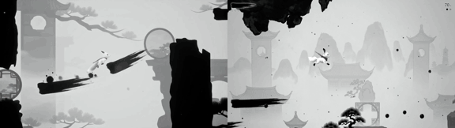

# Ink Fox

**Play it:** [fal-video-to-game.vercel.app/S08_INK-FOX/](https://fal-video-to-game.vercel.app/S08_INK-FOX/)

**Video prompt** (MiniMax H3 Max, `minimax/h3-max/text-to-video`):

> Monochrome ink-wash 3D game, black ink on white rice paper with a single red accent: a small white fox spirit with a red scarf runs and jumps along thick brush strokes that are painted in the air ahead of it as platforms, ink splashes on each landing. Side-on 3D camera.

**Controls:** Auto-runner · Space / ↑ jump (hold = higher) · Shift / X / click paint a brush-stroke platform · ↓ tilts the brush · M sound

**Assets generated on fal:** 50 images, 1 3D models, 7 sounds and music,
22 calls, 3.14 USD.

| Endpoint | Calls |
|---|---|
| `fal-ai/nano-banana-pro/edit` | 9 |
| `fal-ai/elevenlabs/sound-effects/v2` | 7 |
| `fal-ai/nano-banana-pro` | 3 |
| `fal-ai/bria/background/remove` | 1 |
| `tripo3d/h3.1/image-to-3d` | 1 |
| `elevenlabs/music/v2.5` | 1 |

**Code:** [`game/`](game/), written by Claude Opus 5.5 with Three.js only. The assets are not in this repository
(the full game is about 10 to 100 MB); play it at the link above.
