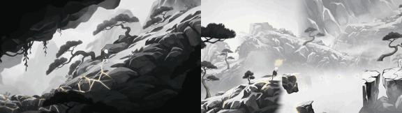

# Kintsugi Mountain

**Play it:** [fal-video-to-game.vercel.app/A01_KINTSUGI-MOUNTAIN/](https://fal-video-to-game.vercel.app/A01_KINTSUGI-MOUNTAIN/)

**Video prompt** (MiniMax H3 Max, `minimax/h3-max/text-to-video`):

> A small monk walks up a black-and-white ink-wash mountain; every footstep blooms gold leaf, and golden kintsugi lines spread through the cracked rocks, healing them as he climbs.

**Controls:** ← → walk · Space / ↑ jump · hold E to mend broken bridges and stones with gold · any key starts · M sound

**Assets generated on fal:** 35 images, 4 3D models, 12 sounds and music,
47 calls, 8.60 USD.

| Endpoint | Calls |
|---|---|
| `fal-ai/nano-banana-pro/edit` | 25 |
| `fal-ai/elevenlabs/sound-effects/v2` | 11 |
| `fal-ai/nano-banana-pro` | 5 |
| `fal-ai/hunyuan-3d/v3.1/pro/image-to-3d` | 2 |
| `meshy/v7.1/image-to-3d` | 1 |
| `fal-ai/meshy/rigging/multi-animation` | 1 |
| `tripo3d/h3.1/image-to-3d` | 1 |
| `elevenlabs/music/v2.5` | 1 |

**Code:** [`game/`](game/), written by Claude Opus 5.5 with Three.js only. The assets are not in this repository
(the full game is about 10 to 100 MB); play it at the link above.
