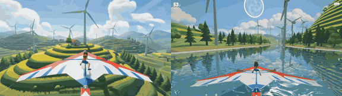

# Kite Rider

**Play it:** [fal-video-to-game.vercel.app/S16_KITE-RIDER/](https://fal-video-to-game.vercel.app/S16_KITE-RIDER/)

**Video prompt** (MiniMax H3 Max, `minimax/h3-max/text-to-video`):

> Watercolor-shaded 3D game: a girl stands on a giant kite, surfing the wind high above rice terraces, leaning to steer between tall wind turbines and diving to skim a lake surface. Chase camera.

**Controls:** ← → lean and steer · ↑ climb · ↓ dive (skim the lake) · Space / Shift wind boost · Space / Enter start · P pause · M sound

**Assets generated on fal:** 12 images, 9 3D models, 8 sounds and music,
34 calls, 4.09 USD.

| Endpoint | Calls |
|---|---|
| `fal-ai/nano-banana-pro/edit` | 14 |
| `tripo3d/h3.1/image-to-3d` | 8 |
| `fal-ai/elevenlabs/sound-effects/v2` | 7 |
| `fal-ai/bria/background/remove` | 2 |
| `meshy/v7.1/multi-image-to-3d` | 1 |
| `fal-ai/nano-banana-pro` | 1 |
| `elevenlabs/music/v2.5` | 1 |

**Code:** [`game/`](game/), written by Claude Opus 5.5 with Three.js only. The assets are not in this repository
(the full game is about 10 to 100 MB); play it at the link above.
