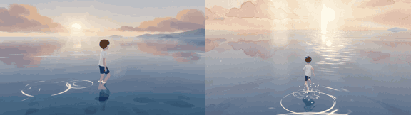

# Mirror Sea

**Play it:** [fal-video-to-game.vercel.app/A04_MIRROR-SEA/](https://fal-video-to-game.vercel.app/A04_MIRROR-SEA/)

**Video prompt** (MiniMax H3 Max, `minimax/h3-max/text-to-video`):

> A boy walks barefoot across an endless mirror-calm sea at dawn; each step sends ripples that reveal faint watercolor memories of a house and a dog beneath the surface.

**Controls:** WASD / arrows walk · Shift run · Space jump (big ripple, big reveal) · Q / E turn the camera · any key starts · M sound

**Assets generated on fal:** 9 images, 8 3D models, 7 sounds and music,
33 calls, 10.02 USD.

| Endpoint | Calls |
|---|---|
| `fal-ai/nano-banana-pro/edit` | 10 |
| `meshy/v7.1/image-to-3d` | 7 |
| `fal-ai/nano-banana-pro` | 6 |
| `fal-ai/elevenlabs/sound-effects/v2` | 6 |
| `fal-ai/birefnet/v2` | 3 |
| `elevenlabs/music/v2.5` | 1 |

**Code:** [`game/`](game/), written by Claude Opus 5.5 with Three.js only. The assets are not in this repository
(the full game is about 10 to 100 MB); play it at the link above.
