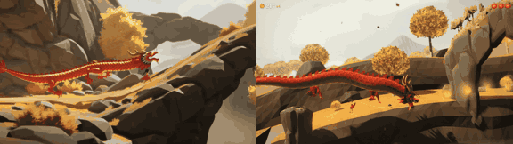

# Paper Dragon

**Play it:** [fal-video-to-game.vercel.app/B06_PAPER-DRAGON/](https://fal-video-to-game.vercel.app/B06_PAPER-DRAGON/)

**Video prompt** (MiniMax H3 Max, `minimax/h3-max/text-to-video`):

> A girl rides a long red paper dragon kite through an autumn canyon, the dragon's paper body rippling as it dives under stone arches and rises over golden trees.

**Controls:** ↑ ↓ / stick fly · hold Space / A rise · ← → lead · Enter / Start play · P / Start pause · M mute

**Assets generated on fal:** 14 images, 8 3D models, 11 sounds and music,
30 calls, 0.79 USD.

| Endpoint | Calls |
|---|---|
| `fal-ai/stable-audio-3/small/sfx/text-to-audio` | 11 |
| `fal-ai/trellis-2` | 9 |
| `fal-ai/birefnet/v2` | 7 |
| `sonilo/v1.1/text-to-sound-effects` | 2 |
| `google/lyria-3.5` | 1 |

**Code:** [`game/`](game/), written by Claude Opus 5.5 with Three.js only. The assets are not in this repository
(the full game is about 10 to 100 MB); play it at the link above.
