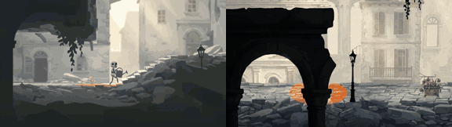

# Rust Bloom

**Play it:** [fal-video-to-game.vercel.app/A05_RUST-BLOOM/](https://fal-video-to-game.vercel.app/A05_RUST-BLOOM/)

**Video prompt** (MiniMax H3 Max, `minimax/h3-max/text-to-video`):

> A small grey robot wanders a colorless ruined city with a watering can; wherever it pours, rust turns into flowers and watercolor color washes outward across the walls.

**Controls:** ← → walk · Space / ↑ jump (hold = higher) · hold J / Shift to pour the watering can · refill at the iron pumps · Enter start

**Assets generated on fal:** 30 images, 3 3D models, 9 sounds and music,
32 calls, 8.45 USD.

| Endpoint | Calls |
|---|---|
| `fal-ai/nano-banana-pro/edit` | 18 |
| `fal-ai/elevenlabs/sound-effects/v2` | 8 |
| `meshy/v7.1/image-to-3d` | 3 |
| `fal-ai/meshy/rigging/multi-animation` | 1 |
| `fal-ai/nano-banana-pro` | 1 |
| `elevenlabs/music/v2.5` | 1 |

**Code:** [`game/`](game/), written by Claude Opus 5.5 with Three.js only. The assets are not in this repository
(the full game is about 10 to 100 MB); play it at the link above.
