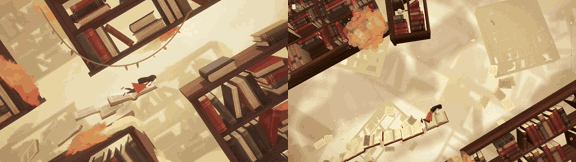

# Sky Library

**Play it:** [fal-video-to-game.vercel.app/A06_SKY-LIBRARY/](https://fal-video-to-game.vercel.app/A06_SKY-LIBRARY/)

**Video prompt** (MiniMax H3 Max, `minimax/h3-max/text-to-video`):

> A girl swims through warm air between towering floating bookshelves; loose pages flutter like birds and she rides a flock of pages upward.

**Controls:** Arrows / WASD swim (or hold click toward the cursor) · Space / Shift ride the flock of pages · Space / Enter start · M sound

**Assets generated on fal:** 11 images, 5 3D models, 8 sounds and music,
29 calls, 5.75 USD.

| Endpoint | Calls |
|---|---|
| `fal-ai/nano-banana-pro/edit` | 15 |
| `fal-ai/elevenlabs/sound-effects/v2` | 7 |
| `fal-ai/hunyuan-3d/v3.1/pro/image-to-3d` | 5 |
| `fal-ai/meshy/rigging/multi-animation` | 1 |
| `elevenlabs/music/v2.5` | 1 |

**Code:** [`game/`](game/), written by Claude Opus 5.5 with Three.js only. The assets are not in this repository
(the full game is about 10 to 100 MB); play it at the link above.
