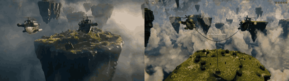

# Skyhook Rescue

**Play it:** [fal-video-to-game.vercel.app/D01_SKYHOOK-RESCUE_coop2/](https://fal-video-to-game.vercel.app/D01_SKYHOOK-RESCUE_coop2/)

**Video prompt** (Seedance 2.5, `bytedance/seedance-2.5/text-to-video`):

> Two-player co-op rescue game during a thunderstorm: two small airships linked by a long cable fly together between floating rock islands, swinging a rescue basket to lift stranded villagers and their goats, then racing to a lighthouse harbor as the storm grows; rain, wind-whipped clouds, lightning, rich painted textures. Chase camera following both airships.

**Controls:** Player 1: WASD fly, R up, F down · Player 2: arrows fly, Enter up, Right Shift down · Space / Enter start · gamepads supported

**Assets generated on fal:** 20 images, 10 3D models, 12 sounds and music,
45 calls, 10.43 USD.

| Endpoint | Calls |
|---|---|
| `fal-ai/nano-banana-pro/edit` | 17 |
| `fal-ai/elevenlabs/sound-effects/v2` | 11 |
| `fal-ai/hunyuan-3d/v3.1/pro/image-to-3d` | 7 |
| `fal-ai/nano-banana-pro` | 3 |
| `tripo3d/h3.1/image-to-3d` | 3 |
| `fal-ai/bria/background/remove` | 2 |
| `fal-ai/birefnet/v2` | 1 |
| `elevenlabs/music/v2.5` | 1 |

**Code:** [`game/`](game/), written by Claude Opus 5.5 with Three.js only. The assets are not in this repository
(the full game is about 10 to 100 MB); play it at the link above.
