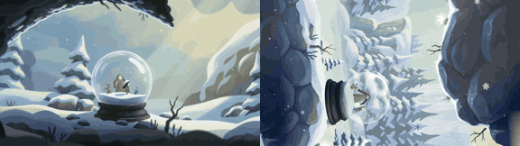

# Snow Globe

**Play it:** [fal-video-to-game.vercel.app/A12_SNOW-GLOBE/](https://fal-video-to-game.vercel.app/A12_SNOW-GLOBE/)

**Video prompt** (MiniMax H3 Max, `minimax/h3-max/text-to-video`):

> A tiny figure lives inside a snow globe; the whole world slowly turns upside down, the snow falls upward and she walks along the curved glass sky.

**Controls:** ← → walk · ↑ hop · Space flips the world (gravity and camera turn 180°) · touch a glass bubble to walk around it · R last safe spot

**Assets generated on fal:** 17 images, 2 3D models, 7 sounds and music,
23 calls, 6.15 USD.

| Endpoint | Calls |
|---|---|
| `fal-ai/nano-banana-pro/edit` | 15 |
| `fal-ai/nano-banana-pro` | 3 |
| `meshy/v7.1/image-to-3d` | 2 |
| `fal-ai/meshy/rigging/multi-animation` | 1 |
| `google/lyria-3.5` | 1 |
| `fal-ai/elevenlabs/sound-effects/v2` | 1 |

**Code:** [`game/`](game/), written by Claude Opus 5.5 with Three.js only. The assets are not in this repository
(the full game is about 10 to 100 MB); play it at the link above.
