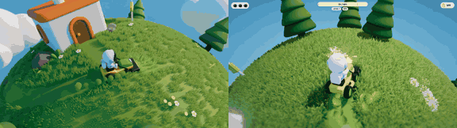

# Space Mower

**Play it:** [fal-video-to-game.vercel.app/S28_SPACE-MOWER/](https://fal-video-to-game.vercel.app/S28_SPACE-MOWER/)

**Video prompt** (MiniMax H3 Max, `minimax/h3-max/text-to-video`):

> Bright stylized 3D game on a tiny round green asteroid: an astronaut drives a little lawn mower around the asteroid, mowing shapes into the grass while small meteors fall and leave craters to avoid. Camera above the curved surface.

**Controls:** ↑ / W drive · ↓ / S brake / reverse · ← → turn on the spot · Shift turbo · Space / Enter start · M sound

**Assets generated on fal:** 14 images, 9 3D models, 9 sounds and music,
45 calls, 8.25 USD.

| Endpoint | Calls |
|---|---|
| `fal-ai/nano-banana-pro/edit` | 15 |
| `fal-ai/elevenlabs/sound-effects/v2` | 8 |
| `fal-ai/trellis-2` | 6 |
| `fal-ai/birefnet/v2` | 5 |
| `fal-ai/nano-banana-pro` | 5 |
| `tripo3d/h3.1/image-to-3d` | 4 |
| `meshy/v7.1/multi-image-to-3d` | 1 |
| `elevenlabs/music/v2.5` | 1 |

**Code:** [`game/`](game/), written by Claude Opus 5.5 with Three.js only. The assets are not in this repository
(the full game is about 10 to 100 MB); play it at the link above.
