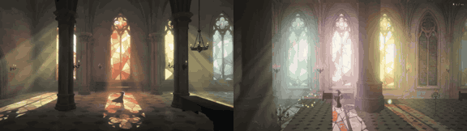

# Stained Glass

**Play it:** [fal-video-to-game.vercel.app/A03_STAINED-GLASS/](https://fal-video-to-game.vercel.app/A03_STAINED-GLASS/)

**Video prompt** (MiniMax H3 Max, `minimax/h3-max/text-to-video`):

> A tiny cloaked figure crosses a vast empty cathedral; sunlight through stained glass windows casts colored shapes on the floor, and only the colored light holds her weight as she leaps from color to color.

**Controls:** ← → run · Space / ↑ jump · hold jump in the air to glide · only colored light holds you · R last light · M sound

**Assets generated on fal:** 8 images, 7 3D models, 8 sounds and music,
26 calls, 8.67 USD.

| Endpoint | Calls |
|---|---|
| `fal-ai/nano-banana-pro/edit` | 12 |
| `meshy/v7.1/image-to-3d` | 7 |
| `fal-ai/nano-banana-pro` | 4 |
| `fal-ai/meshy/rigging/multi-animation` | 1 |
| `google/lyria-3.5` | 1 |
| `fal-ai/elevenlabs/sound-effects/v2` | 1 |

**Code:** [`game/`](game/), written by Claude Opus 5.5 with Three.js only. The assets are not in this repository
(the full game is about 10 to 100 MB); play it at the link above.
