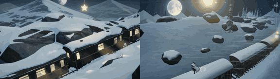

# Starlight Train

**Play it:** [fal-video-to-game.vercel.app/B04_STARLIGHT-TRAIN/](https://fal-video-to-game.vercel.app/B04_STARLIGHT-TRAIN/)

**Video prompt** (MiniMax H3 Max, `minimax/h3-max/text-to-video`):

> A little spirit in a white cloak rides on the roof of a night train crossing snowy mountains, jumping from wagon to wagon to catch falling stars that light the windows below.

**Controls:** ← → ↑ ↓ / WASD / stick or D-pad run · Space / A jump (hold to glide) · Enter / Start start · Esc / Start pause · M sound

**Assets generated on fal:** 9 images, 7 3D models, 17 sounds and music,
25 calls, 2.48 USD.

| Endpoint | Calls |
|---|---|
| `sonilo/v1.1/text-to-sound-effects` | 16 |
| `fal-ai/trellis-2` | 7 |
| `fal-ai/birefnet/v2` | 1 |
| `sonilo/v1.1/text-to-music` | 1 |

**Code:** [`game/`](game/), written by Claude Opus 5.5 with Three.js only. The assets are not in this repository
(the full game is about 10 to 100 MB); play it at the link above.
