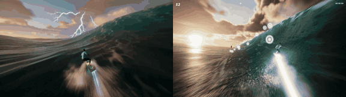

# Storm Surfer

**Play it:** [fal-video-to-game.vercel.app/S30_STORM-SURFER/](https://fal-video-to-game.vercel.app/S30_STORM-SURFER/)

**Video prompt** (MiniMax H3 Max, `minimax/h3-max/text-to-video`):

> Photorealistic 3D game, cutting-edge real-time rendering quality, real-world materials: a surfer on a glowing hoverboard rides a huge stormy ocean wave at dusk, lightning flashing, he carves up the wave face and launches through the spray. Low chase camera.

**Controls:** Space start, then jump (big pop near the lip) · ← → carve the wave · in the air ← → spin · Shift / ↑ boost · P pause

**Assets generated on fal:** 8 images, 3 3D models, 6 sounds and music,
22 calls, 4.38 USD.

| Endpoint | Calls |
|---|---|
| `fal-ai/nano-banana-pro/edit` | 6 |
| `fal-ai/nano-banana-pro` | 6 |
| `fal-ai/elevenlabs/sound-effects/v2` | 5 |
| `meshy/v7.1/image-to-3d` | 3 |
| `fal-ai/bria/background/remove` | 1 |
| `google/lyria-3.5` | 1 |

**Code:** [`game/`](game/), written by Claude Opus 5.5 with Three.js only. The assets are not in this repository
(the full game is about 10 to 100 MB); play it at the link above.
