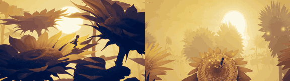

# Sunflower Silhouette

**Play it:** [fal-video-to-game.vercel.app/A15_SUNFLOWER-SILHOUETTE/](https://fal-video-to-game.vercel.app/A15_SUNFLOWER-SILHOUETTE/)

**Video prompt** (MiniMax H3 Max, `minimax/h3-max/text-to-video`):

> A small silhouette child runs through a field of giant sunflowers at golden hour, jumping across huge petals and leaves, two-tone minimal palette of gold and deep indigo.

**Controls:** ← → run · Space / ↑ jump (hold = higher) · hold Space in the air to rise with the scarf · R back to the last flower · M sound

**Assets generated on fal:** 11 images, 1 3D models, 7 sounds and music,
31 calls, 4.68 USD.

| Endpoint | Calls |
|---|---|
| `fal-ai/nano-banana-pro/edit` | 11 |
| `fal-ai/birefnet/v2` | 7 |
| `fal-ai/elevenlabs/sound-effects/v2` | 6 |
| `fal-ai/nano-banana-pro` | 4 |
| `meshy/v7.1/image-to-3d` | 1 |
| `fal-ai/meshy/rigging/multi-animation` | 1 |
| `elevenlabs/music/v2.5` | 1 |

**Code:** [`game/`](game/), written by Claude Opus 5.5 with Three.js only. The assets are not in this repository
(the full game is about 10 to 100 MB); play it at the link above.
