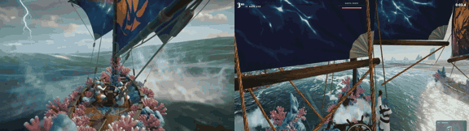

# Tidebound

**Play it:** [fal-video-to-game.vercel.app/H01_TIDEBOUND_coop2/](https://fal-video-to-game.vercel.app/H01_TIDEBOUND_coop2/)

**Video prompt** (MiniMax H3 Max, `minimax/h3-max/text-to-video`):

> Two-player co-op sailing game: two sailors crew a living ship grown from pink coral. One player steers the wheel while the other pulls ropes that open sails made of giant glowing manta-ray wings; the ship surges over huge turquoise storm waves, spray and foam, lightning far away. Chase camera behind the ship.

**Controls:** Title: 1 = solo, 2 = co-op · P1 at the helm: A/D steer, W heave · P2 on the ropes: ↑ haul the manta sails, ↓ ease, ← → brace to the wind

**Assets generated on fal:** 24 images, 11 3D models, 8 sounds and music,
40 calls, 11.01 USD.

| Endpoint | Calls |
|---|---|
| `fal-ai/nano-banana-pro/edit` | 20 |
| `meshy/v7.1/image-to-3d` | 9 |
| `fal-ai/elevenlabs/sound-effects/v2` | 7 |
| `fal-ai/bria/background/remove` | 2 |
| `fal-ai/nano-banana-pro` | 1 |
| `elevenlabs/music/v2.5` | 1 |

**Code:** [`game/`](game/), written by Claude Opus 5.5 with Three.js only. The assets are not in this repository
(the full game is about 10 to 100 MB); play it at the link above.
