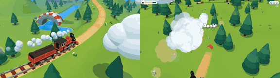

# Train Painter

**Play it:** [fal-video-to-game.vercel.app/S22_TRAIN-PAINTER/](https://fal-video-to-game.vercel.app/S22_TRAIN-PAINTER/)

**Video prompt** (MiniMax H3 Max, `minimax/h3-max/text-to-video`):

> Bright cartoon 3D game: a tiny steam train lays its own rail tracks in front of it as it moves, the player curves the new track left and right across green hills to reach a station on a hill. High chase camera.

**Controls:** ← → curve the track the train lays ahead · ↑ full steam · ↓ brake (tighter turns) · Space whistle / start · P pause · M sound

**Assets generated on fal:** 16 images, 15 3D models, 12 sounds and music,
44 calls, 15.48 USD.

| Endpoint | Calls |
|---|---|
| `fal-ai/nano-banana-pro/edit` | 17 |
| `meshy/v7.1/image-to-3d` | 15 |
| `fal-ai/elevenlabs/sound-effects/v2` | 11 |
| `elevenlabs/music/v2.5` | 1 |

**Code:** [`game/`](game/), written by Claude Opus 5.5 with Three.js only. The assets are not in this repository
(the full game is about 10 to 100 MB); play it at the link above.
