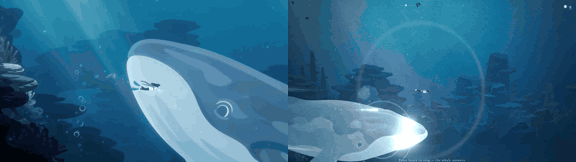

# Whale Song

**Play it:** [fal-video-to-game.vercel.app/A09_WHALE-SONG/](https://fal-video-to-game.vercel.app/A09_WHALE-SONG/)

**Video prompt** (MiniMax H3 Max, `minimax/h3-max/text-to-video`):

> A diver in a red scarf swims beside a giant translucent ghost whale through a deep blue gradient ocean; the whale's song draws glowing lines in the water that she glides along.

**Controls:** WASD / arrows swim · Shift kick hard · Space / E sing (the whale answers and draws light lines to glide on) · Enter play again

**Assets generated on fal:** 11 images, 3 3D models, 6 sounds and music,
40 calls, 5.45 USD.

| Endpoint | Calls |
|---|---|
| `fal-ai/nano-banana-pro/edit` | 21 |
| `fal-ai/birefnet/v2` | 7 |
| `fal-ai/elevenlabs/sound-effects/v2` | 5 |
| `tripo3d/h3.1/image-to-3d` | 3 |
| `fal-ai/nano-banana-pro` | 3 |
| `elevenlabs/music/v2.5` | 1 |

**Code:** [`game/`](game/), written by Claude Opus 5.5 with Three.js only. The assets are not in this repository
(the full game is about 10 to 100 MB); play it at the link above.
